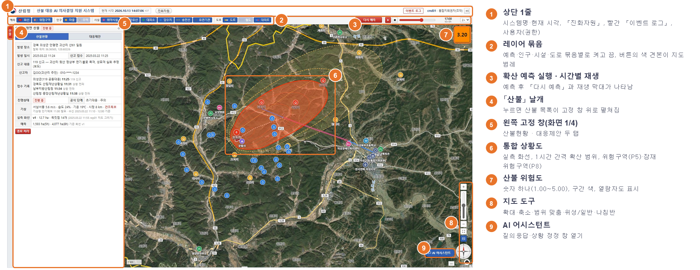
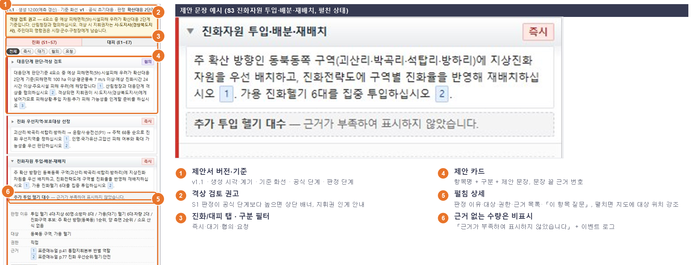
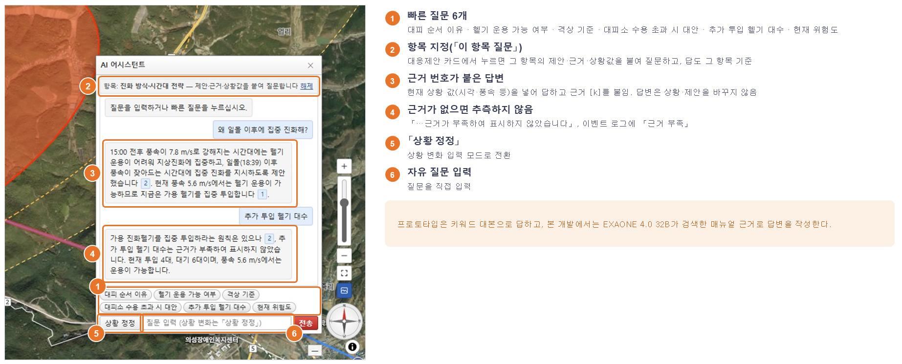
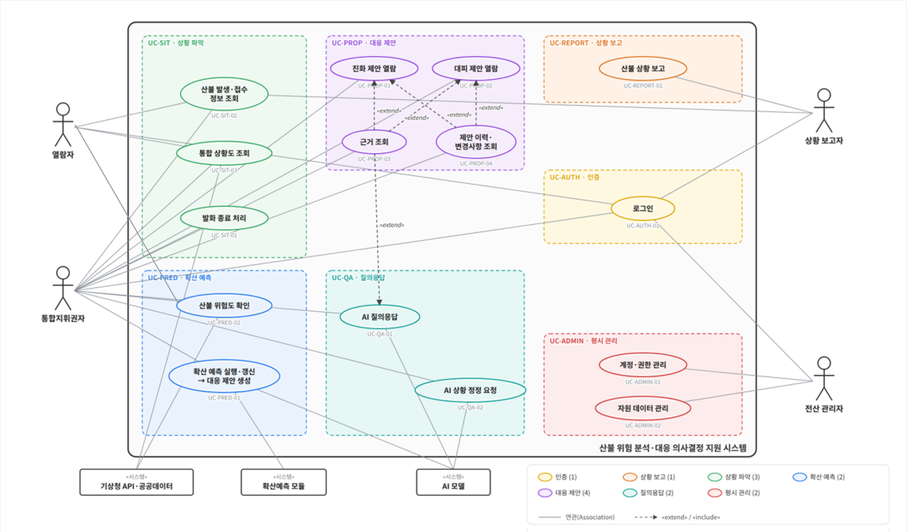

# 산불 대응 AI 에이전트 기반 의사결정 지원 시스템 — 프로토타입

확산 예측과 표준매뉴얼 근거로 산불현장 통합지휘권자(시장·군수·구청장)의 진화·대피 판단을 돕는 서비스의 웹 프로토타입이다.

- 출품: 2026 AI·디지털 기반 사회문제 해결 챌린지 · 분야 ② 아이디어 발굴(프로토타입개발)
- 팀: 산불조심하조
- 시연 영상: https://youtu.be/Nog5yUywHbU
- 시연 시나리오: 2025년 3월 22일 경북 의성군 안평면 산불, 12:00 기준 8시간



## 개요

산불이 번지는 동안 통합지휘권자는 대응단계 격상, 대피 대상과 순서, 진화자원 배치를 짧은 시간 안에 정해야 한다. 그러나 예측·시설·자원 정보는 여러 시스템과 기관에 흩어져 있고, 판단 기준은 100쪽이 넘는 표준매뉴얼에 있다. 이 시스템은 1시간 간격으로 8시간까지의 확산 범위(P1~P8)를 예측하고, 규칙 엔진이 판정 값을 정한 뒤 AI 모델이 매뉴얼 근거를 인용해 진화 7개·대피 7개 판단 항목의 대응 제안서를 만든다. 문장마다 근거 번호가 붙고, 산정 기준이 없는 수량은 만들지 않는다. 시스템은 권고만 하며 최종 결정은 통합지휘권자가 내린다.

처리 흐름

1. 상황 보고자가 발화 위치·신고 내용을 입력하고, 1시간마다 실측 화선을 지도에 그려 보고한다.
2. 통합지휘권자가 확산 예측을 실행하면 P1~P8, 산불 위험도(1.00~5.00), 대응 제안서(v1.1)가 함께 만들어진다. 5시간 안에 불이 닿는 범위(P5)는 위험구역, 8시간 범위(P8)는 잠재 위험구역이다.
3. 제안 문장 끝의 근거 번호를 누르면 표준매뉴얼의 문서·쪽수·조항을 확인한다.
4. AI 어시스턴트에 질문하거나 현장 변화(대피 완료, 헬기 추가 투입 등)를 알리면, 확인을 거쳐 예측은 그대로 두고 제안서만 새 버전(v1.2)으로 다시 만든다.
5. 새 실측 화선이 보고되면 다시 예측해 v2.1을 만들고, 진화가 끝나면 종료 처리한다.

## 실행 방법

설치나 빌드 없이 정적 파일로 동작한다. 지도 라이브러리(MapLibre GL JS)와 지도 타일을 인터넷에서 받으므로 온라인 환경에서 연다.

```bash
git clone https://github.com/wildfire-guard-capstone/prototype.git
cd prototype
python -m http.server 8000
```

브라우저에서 `http://localhost:8000`에 접속한다. Chrome에서 1920×1080·1366×768·1280×720 화면으로 확인했다.

- 입력·정정·관리 화면에서 바꾼 내용은 브라우저 메모리에만 남는다. 로그인은 탭을 닫기 전까지 유지되지만, 새로고침하면 시나리오가 처음 상태로 돌아간다.

### 시연 계정

비밀번호는 모두 `1234`이다. 로그인 화면에서 사용자 구분을 고르면 해당 계정의 아이디와 비밀번호가 채워진다.

| 사용자 구분(권한) | 아이디 | 하는 일 |
|---|---|---|
| 통합지휘권자(조작) | `cmd01` | 확산 예측 실행, 위험도·대응 제안·근거 검토, AI 어시스턴트 질의·상황 정정, 발화 종료 처리 |
| 상황 보고자(보고) | `rep01` | 새 산불 보고(발화 위치·일시·신고 내용·신고자·기관별 접수 기록), 1시간마다 실측 화선 보고 |
| 열람자(열람) | `view01` | 통합 상황도·발생 접수 정보·위험도·진화자원 열람. 대응 제안과 AI 어시스턴트는 보이지 않음 |
| 전산 관리자(관리) | `admin01` | 계정 발급·회수·권한 지정, 진화자원(헬기·차량·인력) 데이터 관리 |

### 따라 해 보기(통합지휘권자)

1. `cmd01`로 로그인한다. 지도에 안평면 산불의 발화점과 첫 실측 화선(v1)이 보인다.
2. 상단 회색 줄 오른쪽의 「확산 예측 실행」을 누른다. 확산 범위와 시간별 재생 막대, 지도 오른쪽 위 위험도 숫자가 나타난다.
3. 왼쪽 「대응제안」 탭에서 제안 문장 끝의 근거 번호를 눌러 근거 창을 연다. 카드 제목을 누르면 판정 이유·대상·권한이 펼쳐진다.
4. 오른쪽 아래 「AI 어시스턴트」에서 빠른 질문 「추가 투입 헬기 대수」를 누른다. 근거가 없는 수량은 답하지 않는다.
5. 「상황 정정」을 누르고 `괴산리 주민 대피 완료했고 헬기 2대 추가 투입했어`를 입력한 뒤 확인하면 제안서 v1.2와 바뀐 문장이 표시된다.

### 시연 옵션

주소 뒤에 붙이면 평소에는 보기 어려운 장면을 띄운다(예: `http://localhost:8000/?merge=1`).

- `?merge=1` — 5시간 확산 범위(P5)가 겹친 두 산불을 하나로 합쳐 보여 준다. 겹친 구역은 보라색으로 칠한다.
- `?fail=…` — 데이터를 가져오지 못했을 때의 화면. `weather`(기상), `predict`(확산 예측), `proposal`(대응 제안), `risk`(위험도), `riskvars`(위험도 변수 일부), `resources`(진화자원), `chat`(AI 답변) 가운데 필요한 것을 쉼표로 잇는다. 확산 예측·대응 제안·위험도·AI 답변은 그다음 한 번의 실행이 실패한다.

## 화면

진화 대응 제안 — 제안 카드, 판정 이유, 근거 번호, 근거 부족 표시



AI 어시스턴트 — 빠른 질문, 항목 질문, 근거 번호가 붙은 답변, 근거 부족 응답



## 판단 항목

표준매뉴얼의 대응단계별 조치 가운데 결정 주체가 통합지휘권자인 것을 14개 항목으로 묶었다. 발동 조건을 만족한 항목만 제안서에 들어가며(「7항목 중 발동 n」), 항목마다 즉시·대기·협의·요청 구분이 붙는다.

| 진화 | 대피 |
|---|---|
| S1 대응단계 판단·격상 검토 | E1 위험구역 설정 |
| S2 진화 우선지역·보호대상 선정 | E2 대피 대상·순서·시점 결정 |
| S3 진화자원 투입·배분·재배치 | E3 취약시설·미대피 주민 조치 |
| S4 진화 방식·시간대 전략 | E4 대피소 배정·분산 |
| S5 시설 보호 조치 | E5 대피 경로·교통통제 |
| S6 유관기관 동원·협조 요청 | E6 재난문자·방송 전파 제안 |
| S7 진화인력 안전·투입 관리 | E7 인명구조·긴급구조 요청 |

## 구현 범위

프로토타입은 화면 배치와 판정·버전·이력·권한·입력 검사를 확인하기 위한 것이다. 기능 32개 가운데 13개는 실제로 동작하고, 확산 모델과 AI 문장은 정해 둔 값으로 보여 준다.

| 구분 | 기능(요구사항 ID) | 프로토타입 | 본 개발 |
|---|---|---|---|
| 구현(13) | 로그인·권한, 진화자원 관리(F-01·31) | 계정 발급·5회 잠금·권한별 첫 화면, 자원 등록·수정·삭제가 실제로 저장·적용 | JWT·서버 측 권한 검사 |
| 구현 | 상황 보고·종료·발생 접수(F-02~04) | 입력 검사, 실측 화선 버전·정정, 종료 후 보고·예측·정정 차단 | DB 저장 |
| 구현 | 통합 상황도·레이어·주요 시설(F-05~07) | SGIS 경계·OSM 시설·도로 표시, 레이어 켜고 끔 | PostGIS 공간 레이어 |
| 구현 | 제안 분류·근거 조회·이력(F-12~14) | 구분 필터, 근거 번호 → 근거 창, 버전 비교·변경 표시 | 조항 단위 근거 원문 연결 |
| 구현 | 상황 정정·이벤트 로그(F-30·32) | 정정 확인 후 저장 → 새 버전, 모든 조작 기록 | EXAONE 정정 해석 |
| 부분 구현(1) | 제안 생성(F-11) | 대응단계·위험구역 등 판정은 규칙으로 계산, 문장은 템플릿 | 규칙 엔진(Python) + EXAONE |
| 미구현(18) | 확산 예측(F-09) | 합성 타원 모델로 P1~P8을 그려 보임 | ELMFIRE(30 m 격자) |
| 미구현 | 위험도·가용 현황(F-10·08) | 계산식은 동작, 23개 변수 값·자원 수는 시연값 | P5 × 격자 자료로 계산 |
| 미구현 | 진화·대피 제안 문장, AI 질의응답(F-15~29) | 정해 둔 문장·키워드 대본 | RAG + EXAONE |

- 화면의 판정 기준 수치와 자원 수는 시연용 근사값·가상값이다. 예를 들어 S1 대응단계 판정의 구간값(평균풍속 4·7 m/s, 예상 진화시간 8·24시간 등)은 근사값이며, 본 개발 규칙 엔진은 산림재난방지법 시행령 별표 3 기준값(피해면적 10·100 ha, 평균풍속 초속 3·11 m, 진화예상시간 5·48시간, 주택 등 주요 시설 20동)을 쓴다.
- 가용 헬기 대수는 진화자원 데이터를 인용한 값이고, 추가 투입 대수처럼 산식이 없는 수량은 「근거가 부족하여 표시하지 않았습니다」로 비워 두고 이벤트 로그에 남긴다.

### 프로토타입과 본 개발 구성

| 구성 요소 | 프로토타입 | 본 개발 |
|---|---|---|
| 웹 화면 | HTML·JavaScript, MapLibre GL JS | React·TypeScript, MapLibre GL JS |
| 확산 예측 | 발화점·풍향·풍속 기반 합성 타원 모델 | ELMFIRE(30 m 격자) |
| 판정 | 브라우저 안 규칙 계산 | 규칙 엔진(Python) |
| 제안 문장·AI 답변 | 정해 둔 문장·키워드 대본, 정정 해석은 정규식 | EXAONE 4.0 32B + 근거 검색(KURE-v1·FAISS) |
| 데이터 | JavaScript 데이터 파일 | PostgreSQL·PostGIS |
| 인증 | 브라우저 세션 저장소 토큰 | JWT, 서버 측 권한 검사 |

본 개발에서 LLM 추론과 근거 검색은 내부 GPU 서버에서만 처리하며, 매뉴얼·상황 데이터를 외부 상용 LLM API로 보내지 않는다.

## Use Case



사람 액터 4종과 시스템 액터 3종(확산예측 모듈, AI 모델, 기상청 API·공공데이터), Use Case 15개로 구성된다.

| UC ID | Use Case | 액터(시스템) | 프로토타입 화면 |
|---|---|---|---|
| UC-AUTH-01 | 로그인 | 통합지휘권자, 열람자, 상황 보고자, 전산 관리자 | 로그인 화면 |
| UC-REPORT-01 | 산불 상황 보고 | 상황 보고자 | 상황 입력 판 |
| UC-SIT-01 | 발화 종료 처리 | 통합지휘권자 | 산불현황 탭 |
| UC-SIT-02 | 산불 발생·접수 정보 조회 | 통합지휘권자, 열람자, 상황 보고자 | 「산불」 날개 목록, 산불현황 탭 |
| UC-SIT-03 | 통합 상황도 조회 | 통합지휘권자, 열람자 / 기상청 API·공공데이터 | 지도, 레이어, 기상, 시간별 재생, 진화자원 창 |
| UC-PRED-01 | 확산 예측 실행·갱신 → 대응 제안 생성 | 통합지휘권자 / 확산예측 모듈, AI 모델 | 「확산 예측 실행」 |
| UC-PRED-02 | 산불 위험도 확인 | 통합지휘권자, 열람자 / 기상청 API·공공데이터 | 위험도 네모 → 팝업 → 요소별 지표 |
| UC-PROP-01 | 진화 제안 열람(S1~S7) | 통합지휘권자 | 대응제안 탭 |
| UC-PROP-02 | 대피 제안 열람(E1~E7) | 통합지휘권자 | 대응제안 탭 |
| UC-PROP-03 | 근거 조회 | 통합지휘권자 | 근거 창 |
| UC-PROP-04 | 제안 이력·변경사항 조회 | 통합지휘권자 | 제안서 버전 이력, 이벤트 로그, 변경 내용 팝업 |
| UC-QA-01 | AI 질의응답 | 통합지휘권자 / AI 모델 | AI 어시스턴트 |
| UC-QA-02 | AI 상황 정정 요청 | 통합지휘권자 / AI 모델 | AI 어시스턴트 → 상황 정정 확인 |
| UC-ADMIN-01 | 계정·권한 관리 | 전산 관리자 | 관리 화면 |
| UC-ADMIN-02 | 진화자원 데이터 관리 | 전산 관리자 | 관리 화면 |

확장 관계(«extend»): 근거 조회(PROP-03)는 진화·대피 제안 열람과 AI 질의응답에서 근거 번호를 누를 때, 제안 이력·변경사항 조회(PROP-04)는 이력을 열거나 '변경' 태그를 누를 때, AI 상황 정정 요청(QA-02)은 질의응답 중 상황 변화를 입력할 때 이어진다.

## 상세 명세

<details>
<summary>기능 요구사항 32개(F-01~F-32)와 프로토타입 동작</summary>

구분은 [구현 범위](#구현-범위) 표와 같다. 진화·대피 항목(F-15~F-28)의 판정 값은 F-11의 규칙 계산으로 정해지고, 제안 문장만 정해 둔 문장으로 채운다.

| 번호 | 기능 | 프로토타입 동작 | 화면 | 구분 |
|---|---|---|---|---|
| F-01 | 로그인·계정·권한 관리 | 잠금 여부를 먼저 확인하고 아이디·비밀번호·사용자 구분이 모두 맞을 때만 진입. 틀리면 「아이디 또는 비밀번호가 올바르지 않습니다」와 실패 횟수 +1, 회수 계정이면 「회수된 계정입니다. 전산 관리자에게 문의하십시오」, 5회 연속 실패하면 잠금. 로그인하면 권한을 담은 세션 토큰을 발급하고(시간 만료 없음), 토큰이 있으면 새로고침해도 바로 진입. 관리자가 계정 발급(아이디·초기 비밀번호 시스템 생성)·회수·재발급·권한 변경·잠금 해제·삭제 | 로그인 화면, 관리 화면 | 구현 |
| F-02 | 산불 상황 보고(발화 정보·실측 화선) | 「새 산불 보고」로 발화 위치(지도 지정 또는 좌표)·발생 일시(선택)·신고 접수 일시·신고 내용·신고자 정보(신고 기관명·성명·연락처, 선택)·기관별 접수 기록을 입력하면 산불이 '접수'로 생성. 실측 화선은 지도에서 꼭짓점을 찍어 그리거나 GeoJSON으로 입력. 처음 받은 보고가 화선 v1(화선이 없으면 발화점 자체가 v1이고 첫 실측 화선은 v2). 「실측 화선 보고」는 직전 화선을 불러와 새 버전으로 제출하고, 「정정」을 고르면 이전 버전을 '정정됨'으로 보존. 이미 예측이 있으면 「재예측 필요」 표시 | 상황 입력 판 | 구현 |
| F-03 | 발화 종료 처리 | '진행 중' 산불에만 「종료 처리」 → 확인 → 종료 상태·종료 시각·처리자 저장. 「종료」 목록으로 옮기고 이후 보고·예측·정정 차단, 제안서·이력은 조회만 | 산불현황 탭 | 구현 |
| F-04 | 산불 발생·접수 정보 조회 | 「산불」 날개의 목록(접수·진행 중 / 종료)에서 선택 → 산불현황 탭 한 표에 발생 장소·발화 위치·발생 일시·신고 접수·신고 내용·신고자·기관별 접수 기록·진행상태·공식 단계·기상·최신 실측 화선 버전, 지도 이동 | 「산불」 날개, 산불현황 탭 | 구현 |
| F-05 | 통합 상황도 | 발화점·실측 화선·1시간 간격 예측 범위(재생 시각까지 채움, 다음 1시간 점선)·위험구역(P5)·잠재 위험구역(P8)과 마을·시설·도로, 의성군 테두리, 기상(현재값·수신 시각)을 한 화면에 표시. 종료된 산불은 발화점·실측 화선만 | 지도, 산불현황 탭, 시간별 재생 | 구현 |
| F-06 | 지도 레이어 선택 | 예측·인구·시설·도로 묶음별 버튼으로 켜고 끔. 버튼에 지도 색 견본 | 상단 2줄 | 구현 |
| F-07 | 주요 시설 지도 표시 | 마을·취약시설·국가유산·대피소·담수지·유관기관 아이콘, 누르면 이름·종류 팝업 | 지도 | 구현 |
| F-08 | 가용 현황 확인 | 헬기·차량·인력 현황을 대기·투입·정비 체크박스로 거름. 관리자 등록값과 상황 정정(헬기 N대 투입 등)이 반영. 못 가져오면 「진화자원 정보를 가져오지 못했습니다」 | 「진화자원」 창 | 미구현(자원 수·호출부호 가상) |
| F-09 | 확산 예측 실행·갱신 | 통합지휘권자가 누를 때만 실행(자동 실행 없음). 최신 실측 화선(없으면 발화점)·기상으로 P1~P8 산출 → 규칙 판정 → 위험도 계산 → 제안서 새 버전. 실패하면 이전 결과를 유지하고 알림 | 상단 2줄 오른쪽 | 미구현(합성 타원 모델) |
| F-10 | 산불 위험도 조회 | 예측 1회마다 P5 기준 위험도 1개 = Σ(가중치 × 변수 등급 1~5) ÷ Σ가중치, 1.00~5.00 숫자만. 23개 변수, 가중치 기상 0.372·지형 0.287·연료 0.266·인프라 0.074. 숫자와 막대는 구간 색(4.00 이상 빨강·3.00 이상 주황·2.00 이상 노랑·1.00 이상 파랑). 네모 → 위험도·4요소 점수 팝업 → 23개 변수 표. 예측 전·종료된 산불은 숨김, 못 가져온 변수는 빼고 계산 | 지도 오른쪽 위 | 미구현(계산식 동작, 변수 값은 시연값) |
| F-11 | 대응 제안 생성·갱신·상세 조회 | 예측 실행·상황 정정 때 새 버전 생성. 버전은 v(화선 버전).(생성 순번) — 첫 제안 v1.1, 정정 후 v1.2, 새 화선 v2 보고 후 재예측 v2.1. 항목을 누르면 판정 이유·대상·권한·근거가 펼쳐지고 지도에 대상 위치 표시. 발동하지 않은 항목과 근거 없는 제안은 넣지 않음 | 대응제안 탭 | 부분 구현(판정 계산, 문장 템플릿) |
| F-12 | 제안 분류 | 진화(S1~S7) / 대피(E1~E7) 탭, 즉시·대기·협의·요청 필터, 「7항목 중 발동 n」 | 대응제안 탭 | 구현 |
| F-13 | 대응 근거 조회 | 제안 문장·AI 답변의 근거 번호를 누르면 근거 창에 해당 문장과 표준매뉴얼 문서·쪽수·조항·요약 표시 | 근거 창 | 구현 |
| F-14 | 제안 이력·변경사항 조회 | 버전·생성 시각·생성 계기·구분 건수·변경 건수 표. 「보기」로 이전 버전 열람, 「비교」로 직전 버전 대비 변경, '변경' 태그 팝업에서 빠진 말·새로 생긴 말 강조 | 제안서 버전 이력 | 구현 |
| F-15 | S1 대응단계 판단·격상 검토 | 4요소(예상 피해면적·평균풍속·예상 진화시간·시설피해) 단계 중 가장 높은 단계를 공식 단계와 비교, 높으면 「협의」로 격상 검토 권고와 지휘권 인계 안내 배너 | 대응제안 탭 | 미구현 |
| F-16 | S2 진화 우선지역·보호대상 선정 | P5 안 인명(마을·취약시설) → 국가유산·송전선 → 주택 순 | 대응제안 탭 | 미구현 |
| F-17 | S3 진화자원 투입·배분·재배치 | 주 확산 방향 구역 우선 배치, 가용 헬기 집중 투입. 추가 헬기 대수는 비표시(근거 부족 안내·로그) | 대응제안 탭 | 미구현 |
| F-18 | S4 진화 방식·시간대 전략 | 현재 풍속의 헬기 운용 가능 여부, 최대 풍속 시간대, 일몰 후 집중 진화 | 대응제안 탭 | 미구현 |
| F-19 | S5 시설 보호 조치 | P5 안 주택군 소방차 배치·예비 살수, 송전선 통과 시 한전 요청 | 대응제안 탭 | 미구현 |
| F-20 | S6 유관기관 동원·협조 요청 | 걸친 시·군·구와 지휘권 인계 필요성, 인접 시·군·소방·경찰·군 동원 요청. 요청 수량은 비표시 | 대응제안 탭 | 미구현 |
| F-21 | S7 진화인력 안전·투입 관리 | P5 안 작업 조 수, 풍상측 퇴로, 최대 풍속 시간대 전방 투입 제한 | 대응제안 탭 | 미구현 |
| F-22 | E1 위험구역 설정 | 화선 도달 5시간 이내 마을 위험구역(즉시), 8시간 이내 잠재 위험구역(대기) | 대응제안 탭 | 미구현 |
| F-23 | E2 대피 대상·순서·시점 결정 | 도달 시각·고령자 순 대피 순위, 야간 도달 마을 일몰 전 사전대피, 대피 완료 마을 제외 | 대응제안 탭 | 미구현 |
| F-24 | E3 취약시설·미대피 주민 조치 | 확산 범위 안 취약시설 별도 이송, 미대피 주민 강제 대피 | 대응제안 탭 | 미구현 |
| F-25 | E4 대피소 배정·분산 | P8 밖 대피소에 마을 인구를 가까운 순으로 배정, 수용 초과 시 분산 | 대응제안 탭 | 미구현 |
| F-26 | E5 대피 경로·교통통제 | 대피로·진입로 겹침 구간 경찰 통제 요청, 겹침 구간 화선 도달 시각 | 대응제안 탭 | 미구현 |
| F-27 | E6 재난문자·방송 전파 제안 | 확산 범위 읍면동에 대피 명령 단계 송출, 송출 이력 반영 | 대응제안 탭 | 미구현 |
| F-28 | E7 인명구조·긴급구조 요청 | 부상·고립 보고가 있으면 소방 긴급구조통제단 요청 | 대응제안 탭 | 미구현 |
| F-29 | AI 질의응답 | 대피 순서·헬기 운용·격상 기준·대피소·위험도·야간·송전선·재난문자·교통통제·자원·근거 질문에 상황값을 넣어 답하고 근거 번호를 붙임(상황·제안은 바뀌지 않음). 빠른 질문 6개, 「이 항목 질문」으로 맥락 지정. 상황 변화 입력은 정정 확인으로 넘김 | AI 어시스턴트 | 미구현(키워드 대본) |
| F-30 | AI 상황 정정 요청 | 대피 완료·부상/고립·헬기/소방차/진화인력 투입 수·예상 진화시간·대피명령·재난문자·공식 단계·위기경보 변화를 입력 → 한 문장의 여러 변화를 모두 확인 카드로 표시 → 저장 후 예측은 그대로 둔 채 제안서 새 버전, 「제안 변경사항」 창 | AI 어시스턴트 → 확인 창 | 구현(해석은 정규식) |
| F-31 | 진화자원 데이터 관리 | 구분·명칭(호출부호)·소속·수량(필수)과 배치 위치·상태로 등록·수정·삭제. 필수 값이 빠지면 저장을 막고, 투입 중 자원은 삭제 불가 | 관리 화면 | 구현 |
| F-32 | 이벤트 로그 | 시스템·입력·예측·제안·근거 부족·정정·종료·관리 구분으로 시각·내용·사용자를 추가 전용 기록, 읽기 전용 열람 | 「이벤트 로그」 창 | 구현 |

</details>

<details>
<summary>Use Case 시나리오 15개</summary>

프로토타입에서 흉내만 내는 단계는 괄호에 표시했다.

### UC-AUTH-01 로그인

| 항목 | 내용 |
|---|---|
| 개요 | 전산 관리자에게 발급받은 계정으로 인증하고 권한(조작·열람·보고·관리)에 맞는 첫 화면으로 들어간다. 회원가입은 없다. |
| 액터 | 통합지휘권자, 열람자, 상황 보고자, 전산 관리자 |
| 시작 조건 | 전산 관리자가 계정과 권한을 미리 발급해 두었다(UC-ADMIN-01). |
| 종료 조건 | 권한이 담긴 세션 토큰이 발급되고 권한에 맞는 첫 화면이 표시된다. 이벤트 로그에 로그인이 남는다. |

기본 흐름
1. 사용자가 사용자 구분을 고르고 아이디·비밀번호를 입력한 뒤 「로그인」을 누른다.
2. 시스템이 잠금 여부를 먼저 확인하고, 비밀번호를 대조하며, 선택한 구분이 계정 권한과 같은지와 회수되지 않았는지 확인한다.
3. 시스템이 권한을 담은 세션 토큰을 발급한다(프로토타입은 브라우저 세션 저장소, 본 개발은 JWT).
4. 시스템이 권한별 첫 화면을 띄운다 — 통합지휘권자·열람자는 진행 중 산불의 통합 상황도, 상황 보고자는 지도와 상황 입력 판, 전산 관리자는 관리 화면.

대안 흐름
- A1. 유효한 토큰이 남아 있으면(새로고침 등) 로그인 없이 권한별 첫 화면으로 바로 들어간다.
- A2. 「로그아웃」을 누르면 토큰을 폐기하고 로그인 화면으로 돌아간다.

예외 흐름
- E1. 아이디·비밀번호가 맞지 않거나 구분이 계정 권한과 다르면 「아이디 또는 비밀번호가 올바르지 않습니다」를 표시하고 실패 횟수를 1 올린다.
- E2. 회수된 계정이면 로그인을 막고 「회수된 계정입니다. 전산 관리자에게 문의하십시오」를 표시한다.
- E3. 5회 연속 실패하면 계정을 잠그고 「계정이 잠겼습니다. 전산 관리자에게 문의하십시오」를 표시한다. 잠금은 전산 관리자만 푼다.
- (프로토타입) 시연용이라 토큰의 시간 만료는 두지 않는다.

### UC-REPORT-01 산불 상황 보고

| 항목 | 내용 |
|---|---|
| 개요 | 처음 보고할 때 발화 위치·발생 일시·신고 내용·신고자·접수 시각·접수 기관을 입력해 산불을 시작하고, 이후 1시간마다 실측 화선(지금 타고 있는 범위의 폴리곤)을 보고한다. 실측 화선이 재예측·제안 재생성의 출발점이며, 화선이 없으면 발화점에서 예측한다. |
| 액터 | 상황 보고자 |
| 시작 조건 | '보고' 권한 계정으로 로그인한 상태 |
| 종료 조건 | 산불이 '접수' 또는 '진행 중'으로 존재하고, 발화 정보와 최신 실측 화선(버전 포함)이 저장되어 상황도·예측의 입력으로 쓰인다. |

기본 흐름
1. 상황 보고자가 상황 입력 판에서 「새 산불 보고」를 누른다.
2. 지도에 발화 지점을 찍고 발생 일시·신고 내용·신고 접수 일시·신고자 정보(선택)를 입력하고, 기관별 접수 기록(접수 기관·접수 시각·접수 경로)을 추가한다.
3. 지금 타고 있는 범위를 실측 화선 폴리곤으로 그린다(「지도에서 그리기」 → 꼭짓점 → 「그리기 완료」, 또는 GeoJSON). 꼭짓점 수와 면적(ha)이 보인다. 초기대응에서 화선이 없으면 생략한다.
4. 「저장(제출)」을 누르면 시스템이 입력값을 검증하고 산불을 '접수' 상태로 만든다. 실측 화선이 함께 제출되면 그 화선을 화선 v1로 저장하고(화선이 없으면 발화점 자체가 v1) 상태를 '진행 중'으로 바꾼다.
5. 시스템이 산불 목록과 지도에 새 산불의 발화점과 실측 화선을 표시하고 이벤트 로그에 「입력」을 기록한다.

대안 흐름
- A1. 1시간 주기 보고: 산불을 고르고 「실측 화선 보고」를 누르면 직전 화선을 불러온다. 다시 그리거나 GeoJSON으로 고쳐 제출하면 새 버전(v2, v3 …)으로 쌓인다. 해당 산불에 예측이 있으면 「재예측 필요」가 표시된다.
- A2. 잘못 보고한 화선의 정정: 제출 방식에서 「정정」을 고르고 수정본을 제출하면 이전 버전은 '정정됨'으로 보존된다.

예외 흐름
- E1. 산불명·발생 장소·발화 위치(국내 좌표)·신고 접수 일시가 비거나 잘못되었거나, 연락처 형식이 틀리거나, 화선 꼭짓점이 3개 미만이면 제출을 막고 잘못된 칸을 빨갛게 표시한다.
- E2. 종료된 산불에는 보고를 받지 않는다(저장 버튼 비활성화, 「종료된 산불은 수정할 수 없습니다」).

### UC-SIT-02 산불 발생·접수 정보 조회

| 항목 | 내용 |
|---|---|
| 개요 | 예측이 아닌 지금 상황 — 어디서 났고, 누가 언제 신고했고, 지금 어떤 상태인지 — 을 확인한다. |
| 액터 | 통합지휘권자, 열람자, 상황 보고자 |
| 시작 조건 | 산불이 1건 이상 보고되어 있다. |
| 종료 조건 | 선택한 산불의 발생·접수 정보와 진행 상태가 표시된다. |

기본 흐름
1. 사용자가 화면 맨 왼쪽 「산불」 날개를 누른다.
2. 시스템이 접수·진행 중인 산불 목록(발생 장소·발생 시각·진행 상태)을 보여 준다.
3. 사용자가 산불을 고르면 산불현황 탭에 발생 장소·신고 내용·신고자·접수 시각·기관별 접수 기록과 진행 상태(최신 실측 화선 버전·입력 시각)·공식 단계·기상이 한 표로 표시되고 지도가 그 산불로 옮겨진다.

대안 흐름
- A1. 목록을 「종료」로 바꾸면 종료 처리된 산불 목록을 보여 준다.
- A2. 상황 보고자는 「실측 화선 보고」로 UC-REPORT-01 A1을 진행한다.

예외 흐름
- E1. 접수·진행 중인 산불이 없으면 「진행 중인 산불이 없습니다」를 표시한다.

### UC-SIT-03 통합 상황도 조회

| 항목 | 내용 |
|---|---|
| 개요 | 지도 한 장 위에 발화점·실측 화선·확산 범위와 마을·시설·진화자원을 겹쳐 "불이 어디까지 오고 그 안에 무엇이 있는지"를 본다. |
| 액터 | 통합지휘권자, 열람자 / 기상청 API·공공데이터 |
| 시작 조건 | 등록된 산불이 1건 이상 있다. |
| 종료 조건 | 실측 화선·예측 범위(P1~P8), 주요 시설, 진화자원 현황이 겹쳐진 상황도가 표시된다. |

기본 흐름
1. 사용자가 통합 상황도를 연다(로그인 후 첫 화면 또는 산불 선택).
2. 시스템이 지도 위에 발화점과 실측 화선을 그리고, 예측 결과가 있으면 P1~P8을 겹치며 위험구역(P5)·잠재 위험구역(P8)을 색을 달리해 강조한다. 산불현황 탭에 현재 기상(풍향·풍속·습도·기온·시정·특보)과 발표·수신 시각이 보인다.
3. 시스템이 마을·담수지·유관기관 등 주요 시설을 아이콘으로 표시한다. 마커를 누르면 이름·종류가 뜬다.
4. 사용자가 레이어 버튼으로 예측·인구·시설·도로를 켜고 끈다. 의성군 테두리는 노란 굵은 선으로 늘 보인다.
5. 사용자가 시간별 확산 재생으로 t = 1 … 8을 재생하면 해당 시점의 P(t)를 채우고 도달한 마을을 빨갛게 강조한다(야간 표시).
6. 사용자가 「진화자원」을 열면 헬기·인력·차량 현황이 보인다. 대기·투입·정비 체크박스로 거른다.

대안 흐름
- A1. 예측 전이면 발화점·실측 화선·시설만 표시한다.
- A2. 종료된 산불이면 P1~P8 없이 발화점과 보고된 실측 화선만 표시한다.

예외 흐름
- E1. 기상 데이터를 못 가져오면 시스템 알림이 잠깐 뜨고, 기상 칸에 경고 아이콘과 「기상 정보를 가져오지 못했습니다」, 그 아래에 마지막으로 받은 값과 수신 시각을 흐리게 표시한다. 진화자원을 못 가져오면 같은 방식으로 알린다. 벡터 지도 스타일을 못 불러오면 기본(래스터) 지도로 대체하고 알린다.

### UC-PRED-02 산불 위험도 확인

| 항목 | 내용 |
|---|---|
| 개요 | 예측 1회마다 P5(5시간 누적 예측 범위) 기준으로 계산한 산불 위험도(1.00~5.00 숫자)와 기상·지형·연료·인프라 요소, 23개 변수를 확인한다. 위험도는 대응단계·위기경보 등에 대응시키지 않는 독립 지표이며 등급 이름도 붙이지 않는다. |
| 액터 | 통합지휘권자, 열람자 / 기상청 API·공공데이터 |
| 시작 조건 | 산불을 골랐고 그 산불의 확산 예측이 실행되었다(UC-PRED-01). |
| 종료 조건 | 위험도 숫자, 4요소 점수·가중치, 23개 변수 표가 표시된다. |

기본 흐름
1. 예측이 끝나면 시스템이 P5 범위의 23개 변수(기상 7·지형 7·연료 7·인프라 2)를 1~5 등급으로 바꾸고, 위험도 = Σ(가중치 × 등급) ÷ Σ가중치를 계산한다.
2. 지도 오른쪽 위 네모에 위험도 숫자(소수 둘째 자리)만 표시하고, 바탕을 구간 색으로 채운다(4.00 이상 빨강·3.00 이상 주황·2.00 이상 노랑·1.00 이상 파랑). 팝업·표·AI 답변에서도 위험도를 뜻하는 숫자는 같은 색으로 표시한다.
3. 네모를 누르면 팝업에 위험도, 1~5 눈금, 4요소 점수·가중치, 기준 화선·P5, 계산 시각이 보인다.
4. 「요소별 지표」(또는 요소 줄)를 누르면 23개 변수 표가 열린다. 묶음별로 변수명·값·단위·가중치·등급을 보여 준다.

대안 흐름
- A1. 다시 예측하면 새 값으로 바꾼다.
- A2. 예측 전이거나 산불이 종료되면 네모를 표시하지 않는다.
- A3. P5가 겹쳐 병합된 산불은 하나의 산불로 보고 합집합 범위의 위험도 1개를 표시한다.

예외 흐름
- E1. 위험도를 계산하지 못하면 시스템 알림이 잠깐 뜨고, 네모에 경고 아이콘과 「—」, 팝업에 「산불 위험도 정보를 가져오지 못했습니다」를 표시한다. 다시 예측하면 다시 계산한다.
- E2. 일부 변수를 못 가져오면 그 변수를 빼고 남은 가중치로 계산하고, 팝업에 「가져오지 못한 지표 n개는 빼고 계산했습니다」, 표의 값 칸에 「가져오지 못함」을 표시한다.

### UC-PRED-01 확산 예측 실행·갱신 → 대응 제안(진화, 대피) 생성

| 항목 | 내용 |
|---|---|
| 개요 | 최신 실측 화선(없으면 발화점)에서 1시간 간격 누적 확산 범위 P1~P8을 예측하고, 그 결과로 진화 7항목·대피 7항목 대응 제안서를 새 버전으로 만든다. 재예측은 통합지휘권자가 버튼을 누를 때만 실행된다. |
| 액터 | 통합지휘권자 / 확산예측 모듈, AI 모델(기상은 기상청 API) |
| 시작 조건 | 상황 보고자가 발화 정보를 입력했다(실측 화선은 없어도 됨). |
| 종료 조건 | 새 예측(P1~P8)과 새 버전의 대응 제안서가 저장·표시된다. |

기본 흐름
1. 통합지휘권자가 최신 실측 화선을 확인하고 「확산 예측 실행」을 누른다(결과가 있으면 「다시 예측」, 실행 중에는 「예측 중 n%」).
2. 시스템이 최신 실측 화선·발화 정보, 기상, 진화자원 가용 현황을 모아 입력을 검증한다.
3. 확산예측 모듈이 P1~P8을 만들고(실측 화선을 포함하도록 확장), 시스템이 상황도에 그리며 위험구역(P5)·잠재 위험구역(P8)을 강조한다(프로토타입은 합성 타원 모델).
4. 규칙 엔진이 대응단계 4요소·마을별 도달 시각·야간·취약시설·국가유산·송전선·주택·대피소 안전/배정/초과·대피로 겹침·진화인력 위치·걸친 행정구역·헬기 운용 가능을 판정한다.
5. AI 모델이 판정 값(바꾸지 않음)과 데이터, 매뉴얼 근거로 S1~S7·E1~E7 제안 문장을 쓰고 문장 끝에 근거 번호를 붙인다. 근거가 없는 수량·문장은 넣지 않고 칸에 「근거가 부족하여 표시하지 않았습니다」로 알리며 이벤트 로그에 「근거 부족」을 기록한다(프로토타입은 템플릿).
6. 시스템이 즉시·대기·협의·요청으로 분류해 새 버전으로 저장하고, 직전 버전과 달라진 항목에 '변경' 태그를 붙이며, 이벤트 로그에 「대응 제안 v1.1 생성(예측 갱신)」을 기록한다.
7. 시스템이 대응 제안 화면을 새 버전으로 갱신하고, 시간별 확산 재생과 위험도 네모를 띄운다.

대안 흐름
- A1. 첫 실행은 '변경' 태그 없이 저장한다. 버전은 v(기준 화선 버전).(그 화선 기준 생성 순번)이다 — 첫 예측은 v1.1, 새 실측 화선 v2가 보고된 뒤 다시 예측하면 v2.1.
- A2. 기상·자원 조건만 바뀌거나 새 실측 화선이 보고되면(「재예측 필요」) 「다시 예측」으로 새 버전을 만든다.
- A3. 판정 단계가 공식 단계보다 높으면 S1이 「협의」가 되고 제안 상단에 격상 검토 권고와 지휘권 인계 안내가 붙는다.

예외 흐름
- E1. 실행 중에는 버튼이 비활성화되어 중복 실행을 막는다.
- E2. 예측이나 제안 생성이 실패하면 직전 예측·위험도·제안서를 그대로 유지하고, 시스템 알림과 함께 버튼 옆(예측) 또는 대응제안 탭(제안)에 「…정보를 가져오지 못했습니다」를 표시한다.
- E3. 종료된 산불이면 버튼이 비활성화되고 옆에 「종료된 산불은 예측할 수 없습니다」가 표시된다.

### UC-PROP-01 진화 제안 열람(S1~S7)

| 항목 | 내용 |
|---|---|
| 개요 | "불을 어떻게 끌 것인가" — 대응단계·보호대상·자원 배분·진화 전략·시설 보호·유관기관·인력 안전 7항목을 항목 상세와 함께 확인한다. |
| 액터 | 통합지휘권자 |
| 시작 조건 | 대응 제안서 버전이 1개 이상 있다. |
| 종료 조건 | 진화 제안서가 항목 상세와 함께 표시된다. |

기본 흐름
1. 사용자가 「대응제안」 탭에서 「진화」를 고른다.
2. 시스템이 버전(예: v1.1)·생성 시각(사유)·기준 화선 버전·공식/판정 단계를 표시한다.
3. 시스템이 발동한 S1~S7 항목을 즉시·대기·협의·요청 배지와 함께 나열하고, 항목마다 제안 문장을 보여 준다. 항목을 누르면 판정 이유·대상·권한·근거가 펼쳐지고 지도에 대상 위치가 표시된다.
4. 사용자가 문장 끝 근거 번호를 누르면 근거 조회(UC-PROP-03)로, '변경' 태그를 누르면 변경 내용 조회(UC-PROP-04)로 넘어간다. 「이 항목 질문」은 AI 어시스턴트에 항목 맥락을 붙인다.

대안 흐름
- A1. 종료된 산불이면 마지막 버전 제안서를 「조회 전용」으로 표시한다.

예외 흐름
- E1. 제안서가 없으면 「확산 예측을 실행하면 제안이 생성됩니다」를 안내한다. 제안 생성에 실패했으면 「대응 제안 정보를 가져오지 못했습니다」를 표시한다.

### UC-PROP-02 대피 제안 열람(E1~E7)

| 항목 | 내용 |
|---|---|
| 개요 | "주민을 어떻게 피신시킬 것인가" — 위험구역 마을·대피 순서와 시점·취약시설·대피소·대피 경로·재난문자·인명구조 7항목을 같은 방식으로 본다. |
| 액터 | 통합지휘권자 |
| 시작 조건 | 대응 제안서 버전이 1개 이상 있다. |
| 종료 조건 | 대피 제안서가 항목 상세와 함께 표시된다. |

흐름은 UC-PROP-01과 같고 1단계에서 「대피」를 고른다. 위험구역·잠재 위험구역 마을과 도달 시각은 E1·E2 문장과 판정 이유에서 확인한다.

### UC-PROP-03 근거 조회

| 항목 | 내용 |
|---|---|
| 개요 | 제안 문장이나 AI 답변 끝의 근거 번호를 눌러 그 문장이 표준매뉴얼의 어느 문서·쪽수·조항에 근거했는지 확인한다. |
| 액터 | 통합지휘권자 |
| 시작 조건 | 근거 번호가 붙은 제안 문장 또는 AI 답변이 화면에 있다. |
| 종료 조건 | 선택한 문장의 매뉴얼 근거(문서·쪽수·조항·요약)가 확인된다. |

기본 흐름
1. 사용자가 문장(또는 AI 답변) 끝의 근거 번호를 누른다.
2. 시스템이 제안 목록 옆에 근거 창을 열고 맨 위에 해당 문장을 다시 보여 준다.
3. 시스템이 그 문장에 연결된 근거 목록(문서명·쪽수·조항·요약)을 나열하고 누른 번호를 강조한다.
4. 표준매뉴얼 원문 대신 해당 부분의 요약을 표시한다.

예외 흐름
- E1. 근거를 불러오지 못하면 「근거를 불러올 수 없습니다」를 안내한다(프로토타입 미구현).

### UC-QA-01 AI 질의응답

| 항목 | 내용 |
|---|---|
| 개요 | 현재 상황·대응 제안·근거를 자연어나 빠른 질문으로 묻고 근거 번호가 붙은 답을 받는다. 상황·제안은 바뀌지 않는다. |
| 액터 | 통합지휘권자 / AI 모델 |
| 시작 조건 | 등록된 산불이 1건 이상 있다. |
| 종료 조건 | 질문과 답이 대화 창에 남는다. |

기본 흐름
1. 통합지휘권자가 화면 오른쪽 아래의 「AI 어시스턴트」를 연다.
2. 시스템이 빠른 질문 6개(대피 순서 이유·헬기 운용 가능 여부·격상 기준·대피소 수용 초과 시 대안·추가 투입 헬기 대수·현재 위험도)를 보여 준다.
3. 통합지휘권자가 질문을 입력하거나 빠른 질문을 누른다.
4. 시스템이 최신 실측 화선·P5·P8 안 마을·시설·최신 버전 제안과 관련 매뉴얼 근거를 모아 AI 모델에 넘긴다(프로토타입은 키워드 대본).
5. AI 모델이 근거 범위 안에서 답을 쓰고 문장 끝에 근거 번호를 붙이며, 시스템이 대화 창에 표시한다.

대안 흐름
- A1. 답의 근거 번호를 누르면 근거 조회(UC-PROP-03)로 이어진다.

예외 흐름
- E1. 관련 매뉴얼 근거를 찾지 못하면 추측으로 답하지 않고 「근거가 부족하여 표시하지 않았습니다」로 알리며 이벤트 로그에 「근거 부족」을 기록한다. 답변을 못 가져오면 「답변을 가져오지 못했습니다」를 표시한다.
- E2. 입력이 질문이 아니라 상황 변화 보고로 판별되면 바로 반영하지 않고 정정 확인으로 넘긴다(UC-QA-02, 확인 전에는 저장하지 않음).

### UC-QA-02 AI 상황 정정 요청

| 항목 | 내용 |
|---|---|
| 개요 | 현장에서 바뀐 사실(대피 완료·자원 투입 등)을 입력하면 변경안을 확인받아 저장하고, 예측은 그대로 둔 채 대응 제안만 다시 만들어 달라진 항목을 보여 준다. |
| 액터 | 통합지휘권자 / AI 모델 |
| 시작 조건 | 대응 제안서 버전이 1개 이상 있다. |
| 종료 조건 | 정정된 상황 값과 새 버전의 대응 제안서가 저장된다. 예측 폴리곤은 바뀌지 않는다. |

기본 흐름
1. 통합지휘권자가 AI 어시스턴트의 「상황 정정」을 누르고 상황 변화를 입력한다(예: "박곡리 대피 완료").
2. AI 모델이 입력을 해석해 변경안(대상: 박곡리 / 항목: 대피 상태 / 이전: 대피 대상 → 이후: 대피 완료)으로 정리한다. 한 문장에 변화가 여럿이면 모두 정리한다(프로토타입은 정규식).
3. 시스템이 변경안을 「상황 정정 확인」 카드로 보여 준다.
4. 「확인 · 저장 후 재생성」을 누르면 시스템이 바뀐 상황 값을 저장하고 이벤트 로그에 「정정」을 기록한다.
5. 시스템이 기존 예측(P1~P8)은 그대로 두고 규칙 판정과 제안 생성만 다시 실행해 새 버전을 저장한다.
6. 시스템이 대화 창에 「제안서 v1.2 생성」을 알리고 「제안 변경사항」 창을 띄우며, 달라진 항목(예: E2)에 '변경' 태그를 붙인다.

입력할 수 있는 변화: 대피 완료, 부상·고립, 헬기·소방차·진화인력 투입 수, 예상 진화시간, 대피명령 발령, 재난문자 송출, 공식 대응단계, 위기경보.

대안 흐름
- A1. 「취소」를 누르면 아무것도 저장하지 않는다.

예외 흐름
- E1. 대상이 데이터에 없거나(예: 대피 대상이 아닌 마을) 해석할 수 없으면 대상을 다시 입력해 달라고 안내한다.
- E2. 제안 재생성에 실패하면 저장된 상황 값은 유지하고 직전 버전을 보여 준다.
- E3. 입력한 값이 가용 범위를 넘으면(예: 헬기 20대 투입) 「가용 범위 초과로 기록할 수 없습니다」로 거부하고 아무것도 저장하지 않는다.
- (프로토타입) 종료된 산불에는 정정을 받지 않는다.

### UC-PROP-04 제안 이력·변경사항 조회

| 항목 | 내용 |
|---|---|
| 개요 | 제안서가 버전별로 쌓인 이력을 보고 직전 버전에서 무엇이 달라졌는지 확인한다. |
| 액터 | 통합지휘권자 |
| 시작 조건 | 제안서 버전이 2개 이상 있다. |
| 종료 조건 | 선택한 버전과 변경 내용, 이벤트 로그가 표시된다. |

기본 흐름
1. 사용자가 「대응제안」 탭 아래 「제안서 버전 이력」을 펼친다.
2. 시스템이 버전 목록(버전·최신 표시·생성 시각·생성 계기[예측 갱신 / 상황 정정]·구분 건수·변경 건수)을 최신순으로 보여 준다. 버전 번호 앞자리가 기준 화선 버전이다.
3. 사용자가 이전 버전의 「보기」를 누르면 그 버전의 제안서 전체가 「이전 버전」 표시와 함께 열린다. 「비교」는 직전 버전 대비 바뀐 항목을 한꺼번에 보여 준다.
4. 사용자가 최신 버전에서 '변경' 태그가 붙은 항목을 누르면 직전 버전 대비 바뀐 내용(이전 문장 → 이후 문장, 빠진 말·새로 생긴 말 강조)이 팝업으로 뜬다.
5. 상단 「이벤트 로그」를 누르면 이벤트 로그(시스템·입력·예측·제안·근거 부족·정정·종료·관리)를 읽기 전용 창에 보여 준다.

예외 흐름
- E1. 버전이 하나뿐이면 「비교할 이전 버전이 없습니다」를 안내한다.

### UC-SIT-01 발화 종료 처리

| 항목 | 내용 |
|---|---|
| 개요 | 진화가 끝난 산불을 통합지휘권자가 종료 상태로 바꿔 사건을 닫는다. |
| 액터 | 통합지휘권자 |
| 시작 조건 | 종료할 산불이 '진행 중' 상태 |
| 종료 조건 | 「종료」 상태와 종료 시각이 저장되고 제안서·이력은 조회만 가능하다. |

기본 흐름
1. 통합지휘권자가 「산불」 날개에서 해당 산불을 고르고 산불현황 탭의 「종료 처리」를 누른다.
2. 시스템이 「종료하면 상황 보고·예측 실행·상황 정정이 막힙니다」 확인 창을 띄우고, 통합지휘권자가 「확인」을 누른다.
3. 시스템이 상태를 「종료」로 바꾸고 종료 시각·처리자를 저장하며 이벤트 로그에 종료를 기록한다.
4. 시스템이 그 산불을 「종료」 목록으로 옮기고, 이후 상황 보고·예측 실행·상황 정정을 비활성화한다. 재생을 멈추고 지도에서 P1~P8을 지운다.

대안 흐름
- A1. 확인 창에서 「취소」를 누르면 '진행 중' 상태를 유지한다.

예외 흐름
- E1. 이미 종료된 산불과 '접수' 산불에는 「종료 처리」 버튼이 없다.

### UC-ADMIN-01 계정·권한 관리

| 항목 | 내용 |
|---|---|
| 개요 | 전산 관리자가 평시에 사용자 계정을 발급·회수하고 조작·열람·보고 권한을 나눈다. 모든 계정은 여기서만 생기며 관리 권한 계정은 설치 시 사전 발급한다. |
| 액터 | 전산 관리자 |
| 시작 조건 | 전산 관리자로 로그인 |
| 종료 조건 | 계정·권한이 저장되어 로그인에 쓰인다. |

기본 흐름
1. 시스템이 관리 화면에 계정 표(아이디·이름·소속·권한·상태·발급일)와 집계(발급·회수·잠금·권한별)를 표시한다.
2. 전산 관리자가 이름·소속·권한(조작·열람·보고)을 입력하고 「계정 발급」을 누른다.
3. 시스템이 아이디를 자동 생성해(권한별 접두어 + 순번, 중복 검사) 저장하고 초기 비밀번호를 만들어 보여 준다.
4. 계정을 거둘 때 「회수」를 누르면 비활성화되어 이후 로그인이 막힌다.
5. 발급·권한 변경·회수·재발급·잠금 해제·삭제는 이벤트 로그에 「관리」로 기록된다.

대안 흐름
- A1. 행의 권한을 바꾸면 저장 즉시 새 권한이 적용된다.
- A2. 「재발급」은 초기 비밀번호를 다시 발급한다(회수된 계정은 다시 발급 상태가 됨).
- A3. 잠긴 계정은 「잠금 해제」로 풀고 실패 횟수를 0으로 초기화한다.
- A4. 「삭제」로 계정을 지운다(로그인 중인 자기 계정은 삭제 불가).

예외 흐름
- E1. 이름·소속·권한 중 빈 값이 있으면 발급을 막고 빠진 칸을 표시한다.
- E2. 회수·삭제·권한 변경은 확인 창을 거치며, 발급 상태의 조작 권한 계정이 하나뿐이면 그 계정의 회수·삭제·권한 변경을 막는다.

### UC-ADMIN-02 진화자원 데이터 관리

| 항목 | 내용 |
|---|---|
| 개요 | 전산 관리자가 보유 헬기·차량·인력 데이터를 등록·수정·삭제한다. |
| 액터 | 전산 관리자 |
| 시작 조건 | 전산 관리자로 로그인 |
| 종료 조건 | 진화자원 데이터가 저장되어 재난 시 조회·제안에 쓰인다. |

기본 흐름
1. 시스템이 자원 목록(구분·명칭(호출부호)·소속·수량·배치 위치·상태)과 구분별 보유·투입·대기·정비 집계를 보여 준다.
2. 전산 관리자가 새 자원을 등록하거나 행의 값을 고쳐 「저장」하거나 「삭제」한다.
3. 시스템이 필수 값(구분·명칭(호출부호)·소속·수량)을 검사하고 저장한 뒤 이벤트 로그에 「관리」로 기록한다.
4. 저장된 값은 통합 상황도의 진화자원 현황과 다음 대응 제안 생성(S3·S6)의 입력으로 쓰인다.

예외 흐름
- E1. 필수 값이 빠지면 저장을 막고 빠진 칸을 표시한다.
- E2. 산불에 투입 중인 자원은 삭제할 수 없다.

</details>

## 데이터 출처와 실제·가상 구분

| 항목 | 구분 | 출처·비고 |
|---|---|---|
| 의성 안평면 산불의 발화점·발생(11:24)·신고(11:25)·원인 | 실제 | 산림청 X 게시물, 이데일리 보도, 위키백과. 좌표는 OSM 괴산리 마을 중심점 |
| 마을·면사무소·학교·사찰·복지시설·저수지 좌표, 도로·철도 선형 | 실제 | OpenStreetMap(Overpass API). 저수지의 헬기 담수 가능 여부는 확인하지 않음 |
| 군·읍면 경계, 읍면 인구 | 실제 | SGIS(통계지리정보서비스). 화면에는 의성군 테두리만 표시하고 읍면 경계는 판정에만 사용 |
| 위성영상·바탕지도 | 실제 | Esri World Imagery, OpenFreeMap |
| 확산 범위 P1~P8 | 합성 | 발화점·풍향·풍속 타원 모델. 최신 실측 화선 폴리곤을 포함하도록 확장 |
| 실측 화선 v1(12.7 ha), 사곡면·점곡면 산불, 기관별 접수 기록(11:31 이후), 신고자 정보, 유관기관 위치, 마을별 인구·고령·장애, 주택 점, 기상 시계열(풍속 5.6 m/s 외)·습도·시정, 대피소 수용 인원, 요양병원 위치, 송전선, 대피로·진입로, 진화자원(28건)·호출부호·배치 위치, 계정·소속 | 가상 | 구하지 못했거나 시연을 위해 만든 값. 신고자 성명·연락처는 일부를 가린 가상값 |
| 위험도 23개 변수 값(안평면 1·2회차, 사곡면, 병합 시연)과 결측 변수 시연 | 시연값 | 변수·단위·구간·가중치는 AI Hub 「산불 확산 위험 대응방안 추론 데이터」 저작도구의 위험도 기준. 25개 변수 중 23개를 쓰고 가중치는 합(0.94)으로 나눠 다시 맞춤 |
| 근거 텍스트 | 요약 | 「산불 재난」 위기관리 표준매뉴얼(2026.6 일부개정)의 쪽수 기준 요약. 원문은 공개 자료가 아니어서 싣지 않음 |

- 2025년 당시 대응단계는 1·2·3단계였으나 화면은 2026년 개편 체계(초기대응·확산대응 1·2단계)로 표시한다.
- 화면 배치는 산림청 산불상황관제시스템을 참고했다.
- 지도 화면의 출처 표기는 오른쪽 아래 i 아이콘에 두었다(마우스를 올리면 펼침).

## 파일 구성

| 파일 | 내용 |
|---|---|
| `index.html` | 화면 구조·스타일(로그인, 상단 메뉴·레이어·확산 예측 줄, 왼쪽 고정 창, 지도·위험도 네모, 상황 입력 판, AI 어시스턴트, 진화자원·이벤트 로그·위험도 창, 관리 화면, 확인 창, 실패 알림) |
| `app.js` | 지도, 합성 확산 모델, 규칙 판정, 제안 템플릿, 위험도 계산, 병합 산불, 제안 버전·이력·이벤트 로그, AI 어시스턴트 대본·상황 정정, 산불 상황 보고, 관리 화면, 로그인 토큰·권한별 화면 제어 |
| `data.js` | 시나리오 데이터(산불·접수 기록·실측 화선, 마을, 시설, 대피소, 유관기관, 기상, 위험도 변수, 진화자원, 계정, 근거 요약, 판단 항목, 시연 옵션 설정) |
| `data_boundaries.js` · `data_osm_lines.js` · `data_water.js` | SGIS 경계, OSM 도로·철도, OSM 저수지 |
| `assets/logo.png` | 정부 상징 |
| `docs/` | README 그림(화면 3장, Use Case 다이어그램) |
